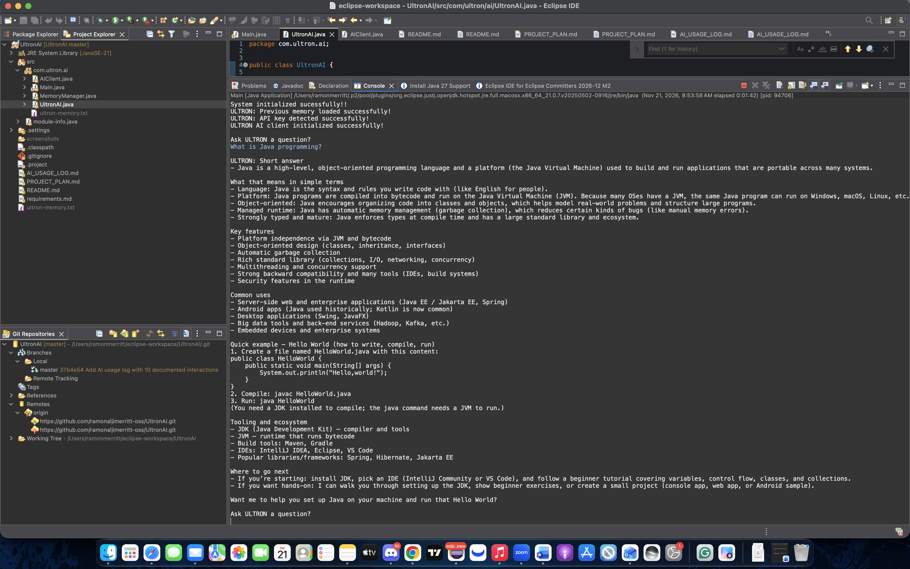

# ULTRON - Java AI Personal Assistant

## Project Overview

ULTRON is a Java-based artificial intelligence
assistant developed using Eclipse and the OpenAI API.

The purpose of this project is to demonstrate how
AI-assisted software development can be used to
design, build, test, and improve a working application.

ULTRON allows users to ask questions, receive
AI-generated answers, and save conversation history.

## Features

- Interactive Java console interface
- OpenAI API integration
- AI-generated responses
- Conversation context during active sessions
- Local memory storage
- Memory retrieval after restarting
- Exit command to close the application
- Basic error handling

## Installation Instructions

1. Install the Java Development Kit (JDK).
2. Install Eclipse IDE for Java Developers.
3. Download or clone the ULTRON GitHub repository.
4. Import the project into Eclipse.
5. Configure the OPENAI_API_KEY environment variable
   with your own OpenAI API key.
6. Ensure your computer has internet access.
7. Run Main.java.

Note: OpenAI API access may require billing credits.

## Usage Guide

1. Launch ULTRON in Eclipse.
2. Wait for the welcome message.
3. Type a question in the console.
4. Press Enter.
5. Read ULTRON's response.
6. Continue asking questions as needed.
7. Type "exit" to close the application.

Example:

User: What is Java programming?

ULTRON: Java is a programming language used
to develop applications and software.

## Screenshots

### ULTRON Answering a Java Programming Question

The screenshot below demonstrates ULTRON
successfully answering a programming question
through the Eclipse Console.

## Screenshots

Screenshots demonstrating ULTRON's operation
will be added to this section before submission.

## Technologies Used

- Java
- Eclipse IDE
- OpenAI API
- Git
- GitHub

## AI-Assisted Development

ChatGPT was used throughout the development process
to assist with planning, Java programming,
troubleshooting, debugging, testing, and documentation.

An AI Usage Log documents the prompts used,
AI-generated suggestions, student modifications,
and final implementation results.

## Future Enhancements

- Graphical user interface
- Voice commands
- Improved long-term memory management
- Additional productivity features
- More advanced error handling

## Security

The OpenAI API key is configured through an
environment variable rather than stored in
the Java source code.

Private memory files are excluded from GitHub
using .gitignore.

## Project Status

Core application functionality implemented
and tested successfully.
